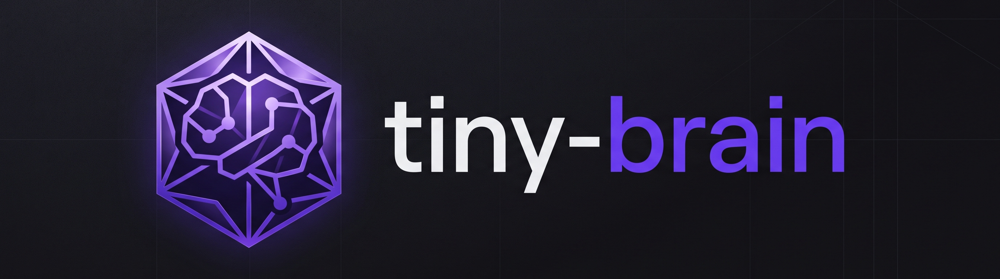

# Tiny Brain

Tiny Brain is a local, safety-first interface to an Obsidian vault. Markdown remains the canonical source of truth; SQLite, FTS5, embeddings, audit records, and model state are derived operational data.

The software runs on a private home network with zero external cloud dependencies (`TINY_BRAIN_RUNTIME_OFFLINE=true`), enforcing a strict proposal-only mutation workflow where the language model cannot execute arbitrary file writes, deletes, or shell commands.

---

## Model & Hardware Specifications

Tiny Brain is tuned specifically for low-power home server hardware (Intel Core i7-8550U NUC with 16 GB RAM) and operates completely offline:

| Component | Specification | Details |
| :--- | :--- | :--- |
| **Conversational Chat Model** | **Gemma-4-E2B-it** | Quantized as **`gemma-4-E2B-it-q4_k_m.gguf`** (Q4_K_M) |
| **Inference Engine** | **`llama.cpp` server** | Official Docker image (`ghcr.io/ggml-org/llama.cpp:server` / `server-vulkan`), OpenAI-compatible HTTP API on port 8080 |
| **CPU / Hardware Tuning** | **4 Physical Threads (`-t 4`, `-tb 4`)** | Avoids hyperthreading L3 cache thrashing and thermal throttling on the i7-8550U |
| **Context & KV Optimization** | **8,192 tokens** with **Flash Attention (`-fa on`)** and **`q8_0` KV cache** | Quantized KV cache (`-ctk q8_0 -ctv q8_0`) reduces memory footprint ~32x; bounded context (`TINY_BRAIN_CONTEXT_TOKENS=8192`) |
| **KV Slot Persistence** | **Single slot (`-np 1`)** | Retains deterministic system prompt prefix in KV cache for 0ms prompt prefill between turns |
| **Reasoning Mode** | **Fast Chat (Default)** with **Deep Think Toggle** | Thinking tokens disabled by default to eliminate 40–85s of CPU reasoning wait time; can be toggled on demand |
| **Embedding Model** | **`BAAI/bge-small-en-v1.5`** | 384 dimensions, normalized vector embeddings |
| **Embedding Runtime** | **`fastembed`** (default, ONNX) or **`sentence-transformers`** | Runs locally on CPU; benchmarkable via `scripts/benchmark_embeddings.py` |

---

## Current Implementation

### Vault Parsing & Indexing
- **Safe Path Protection**: Relative-path validation, rejection of absolute paths, parent directory traversal (`..`), hidden paths, and symlink escapes.
- **Markdown & Frontmatter Extraction**: Full extraction of YAML frontmatter, headings (`#`), tags (`#tag`), markdown links, and Obsidian wikilinks (`[[target]]`, `[[target|alias]]`).
- **Heading-Aware Chunking**: Deterministic splitting by Markdown heading structure, maintaining hierarchical breadcrumbs (`[Doc: note.md > Section: Heading]`) and unique section IDs with bounded oversized-section splitting.
- **SQLite WAL Schema**: Managed schema storing notes, sections, FTS5 full-text index (`fts_sections`), vector embeddings (`section_embeddings`), link graph (`links`), sessions, change proposals (`change_proposals`), audit log (`audit_records`), and indexing jobs (`index_jobs`).
- **Incremental & Full Indexing**: Fast file-hash change detection, incremental sync, and last-known-good index recovery.

### Retrieval & Zero-Shot RAG Pipeline
- **Deterministic Search Planning**: Instant (<0.05ms) intent detection and keyword extraction in Python (`search_planner.py`). Skips retrieval on greetings, pleasantries, and trivial acknowledgments; extracts wikilinks and quoted phrases without calling the LLM.
- **Multi-Channel Grounding**: Parallel SQLite lookup combining lexical FTS5 BM25, semantic vector similarity, 1-hop inbound backlinks, outgoing wikilinks, and `#tag` matches.
- **Reciprocal Rank Fusion (RRF)**: Merges multi-channel hits into a unified ranked context budget.
- **Zero-Shot RAG**: Context is injected directly into prompt blocks with `tools=None` for standard Q&A, eliminating ~500 tokens of tool schema bloat and preventing small-model tool loop confusion.
- **General Knowledge Fallback**: Answers general conversational questions cleanly without hallucinating nonexistent vault notes when no relevant context is found.
- **Strict Citation Validation**: Assistant citations (`[S1]`, `[S2]`) are verified against retrieved section IDs, ensuring all references point to actual vault notes.

### Safe Mutations & Memory Gate
- **Two-Stage Memory Gate**: Stage 1 regex/cue heuristic gate filters >95% of non-durable conversational turns; Stage 2 llama.cpp GBNF grammar constraints guarantee structured JSON memory extractions (`{"type": ..., "conf": ..., "fact": ...}`) appended to `_AI/Inbox.md` with source message provenance.
- **Proposal-Only Writes**: The model has no arbitrary filesystem, shell, or Git execution. All vault changes are recorded as proposals requiring explicit human review.
- **Three-Way Merge Conflict Handling**: Base content hash verification prevents silent overwrites; conflicts trigger three-way merge resolution.
- **Atomic Operations & Audit**: Atomic temporary-file replacement, immediate re-indexing, JSON audit logs, and focused Git commits using a configured deployment author.

### Web Interface & Services
- **FastAPI Backend**: Server-rendered HTML (Jinja2) and JSON API.
- **Interactive Chat (`/`)**: Real-time token streaming via Server-Sent Events (SSE), dynamic "Fast Chat" / "Deep Think" toggle, chat session history persistence, and inline proposal diff previews.
- **Vault Search (`/search`)**: Real-time multi-channel search across notes, headings, and tags.
- **Note Inspector (`/notes/{path}`)**: Rendered markdown preview, metadata summary, backlinks, and Obsidian URI deep-links (`obsidian://open?vault=...&file=...`).
- **Changes Dashboard (`/changes`)**: Unified diff inspection, revision requests, approval, rejection, and commit revert.
- **System Status (`/status`)**: Live index statistics, note counts, embedding status, and system health metrics.

---

## Local Development

Install dependencies and test runner:

```powershell
python -m pip install -e ".[test]"
python -m pytest
```

Inspect an Obsidian vault export archive:

```powershell
python scripts/inspect_vault.py obsidian-vault.zip
```

Run a temporary local vault and server:

```powershell
$env:TINY_BRAIN_VAULT_ROOT = "$PWD\vault"
$env:TINY_BRAIN_DATABASE = "$PWD\data\database.sqlite"
python scripts/index_vault.py $env:TINY_BRAIN_VAULT_ROOT $env:TINY_BRAIN_DATABASE
python -m tiny_brain.main
```

### Performance & Benchmarking Utilities

- **Chat Model Benchmark**:
  ```powershell
  python scripts/benchmark_model.py --base-url http://127.0.0.1:8080/v1 --model gemma-4-E2B-it-q4_k_m.gguf
  ```
- **Embedding Runtime Benchmark** (`fastembed` vs `sentence-transformers` on `BAAI/bge-small-en-v1.5`):
  ```powershell
  python scripts/benchmark_embeddings.py
  ```
- **End-to-End Application Benchmark** (measures TTFT, generation throughput, and draft generation rate):
  ```powershell
  python scripts/benchmark_app.py
  ```

---

## Deployment Outline

1. **Host Discovery**: Inspect the target host (e.g. Intel NUC at `192.168.1.117`, user `inigo`); verify Docker, storage paths, firewall, and device permissions before provisioning.
2. **Directory Structure**: Create `/srv/tiny-brain/{vault,data,models,staging,compose}` on the host with the target UID/GID (`TINY_BRAIN_PUID`, `TINY_BRAIN_PGID`).
3. **Safe Vault Extraction**: Copy the vault archive to staging, validate with `scripts/inspect_vault.py`, reject unsafe paths, and extract with `scripts/import_vault.py`.
4. **Git Initialization**: Initialize Git in the canonical vault using `scripts/init_vault_git.py`, configure the deployment author, and create the initial import commit before enabling writes.
5. **Environment Configuration**: Copy `deployment/compose.env.example` to `/srv/tiny-brain/compose/.env`, verify volume paths, and pin the `llama.cpp` server image digest/release.
6. **Chat Model Installation**: Place the verified `gemma-4-E2B-it-q4_k_m.gguf` in `/srv/tiny-brain/models/` and record its SHA-256 checksum in `model_metadata`.
7. **Start Stack**: Launch Docker Compose (`docker compose up -d`), trust Caddy's internal CA on client devices (`https://tiny-brain.home.arpa`) or connect via LAN HTTP (`http://192.168.1.117/`), and run the initial vault index.
8. **Syncthing Pairing**: Pair Syncthing separately. Keep its web GUI bound to localhost (`127.0.0.1:8384`); do not expose it through Caddy.
9. **Benchmark & Verify**: Benchmark `gemma-4-E2B-it-q4_k_m.gguf` (`scripts/benchmark_model.py`) and the embedding runtimes (`scripts/benchmark_embeddings.py`) on representative notes before enabling automatic Inbox writes.
10. **Backups**: Configure automated backups with `deployment/backup.sh` to produce independent vault, operational database, audit log, and Git bundle archives.

---

## Security and Operations

- **Network Perimeter Security**: This release has no application user authentication. Access is restricted to the trusted local home LAN (`192.168.1.117` or `https://tiny-brain.home.arpa`). Caddy internal TLS encrypts traffic and authenticates the service certificate; it does not identify individual users. Do not expose service ports to the public internet.
- **Zero Arbitrary Execution**: The model has no arbitrary shell, filesystem, Git, delete, move, or bulk-rewrite tool. Application code strictly validates every path and mutation. If a write succeeds but indexing or Git fails, the proposal is marked `recovery_required` and must be resolved before proceeding.
- **Independent Disaster Recovery**: Markdown in the vault is the single source of truth. The SQLite database, FTS5 index, and embeddings can always be re-indexed from scratch from the Markdown files. Back up the vault, SQLite database, JSON audit directory, Git repository, Compose configuration, Caddy data, Syncthing configuration, and model checksums separately.
