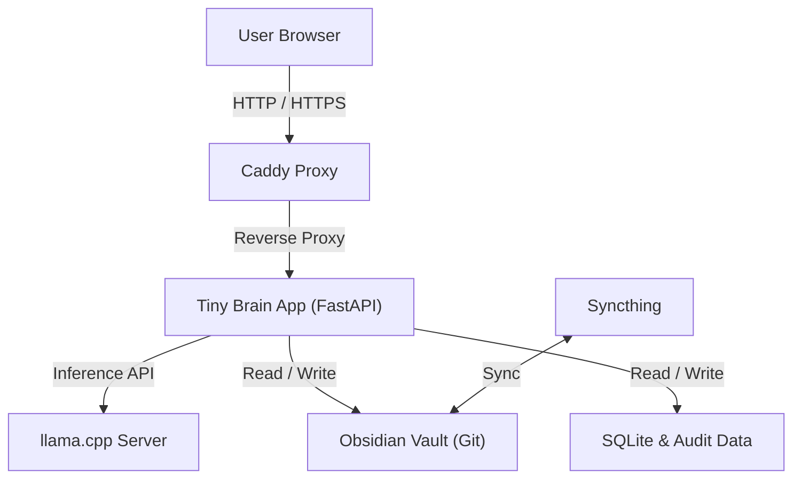
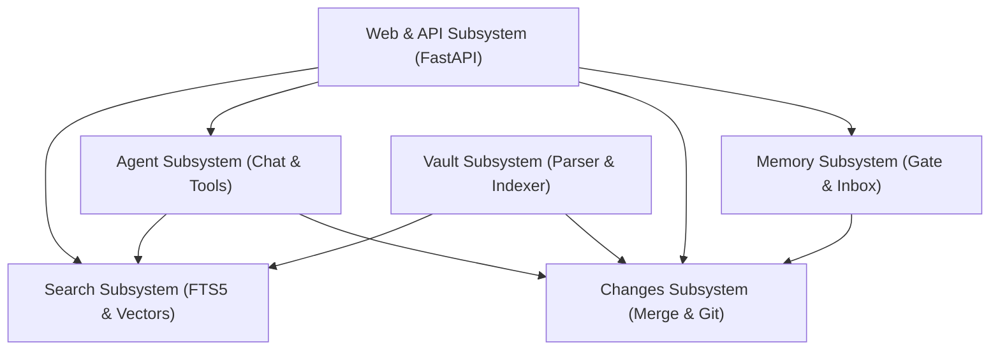

# Repository Overview: Tiny Brain

## 1. Introduction and Purpose

Tiny Brain is a local software system for personal knowledge management.
The system provides a conversational interface to an Obsidian vault.
Markdown files in the vault remain the canonical source of knowledge.
The software runs on a private local area network.
All language model processing occurs locally on host hardware.
External cloud services do not receive user notes or user queries.

The system helps users find, connect, and update notes.
Users query the vault through a web browser.
The assistant provides answers with grounded source citations.
The assistant cannot make direct, unverified changes to notes.
Every proposed modification requires explicit user approval.
The software maintains complete audit records for all operations.

## 2. Core Architectural Principles

Tiny Brain follows four primary design principles.
First, Markdown files are the single source of truth.
SQLite databases, search indices, and vector embeddings contain derived data only.
An operator can delete all derived databases at any time.
The system can reconstruct all indices directly from the Markdown vault.
The index cannot reconstruct the vault if files are lost.

Second, the system enforces a safety-first operational policy.
The language model has no access to a command shell.
The language model cannot execute arbitrary file system writes.
The software validates all file paths against strict security rules.
Symbolic links and directory traversal attempts cause immediate errors.
Every write operation uses a three-way merge check.

Third, the architecture requires offline local execution.
The system operates without an internet connection during normal use.
A local instance of llama.cpp executes the conversational model.
Local embedding libraries generate text vector representations.
Users keep complete ownership and privacy of their data.

Fourth, all state transitions remain visible and auditable.
The system records all proposal events in SQLite and JSON logs.
Approved note modifications create focused Git commits in the vault.
Every commit message includes the change description and reason.
Users can revert any approved change through the web interface.

## 3. System Architecture and Services

Docker Compose manages the deployment architecture.
The Compose configuration defines four isolated container services.
These services communicate over an internal bridge network.
Figure 1 shows the component relationships and service connections.

### 3.1 Application Service (`app`)

The `app` service runs the Tiny Brain Python application.
FastAPI and Uvicorn provide the application server framework.
The container runs under an unprivileged user account.
The container mounts the vault directory, data directory, and model directory.
The service depends on the healthy status of the `llama` service.

### 3.2 Inference Service (`llama`)

The `llama` service executes local language model inference.
The container runs the official llama.cpp server image.
The server loads a quantized GGUF model from the models directory.
The default configuration uses the Gemma-4-E2B-it model in Q4_K_M quantization (`gemma-4-E2B-it-q4_k_m.gguf`).
The service exposes an OpenAI-compatible HTTP interface on port 8080.
A container health check monitors the HTTP health endpoint.

### 3.3 Gateway and Proxy Service (`caddy`)

The `caddy` service operates as a reverse proxy.
Caddy routes incoming local traffic to the application service.
Port 80 serves unencrypted HTTP traffic across the local network.
Port 443 serves encrypted HTTPS traffic for the configured local domain.
Caddy generates local TLS certificates through an internal certificate authority.
Clients must trust the internal root certificate of Caddy.

### 3.4 Synchronization Service (`syncthing`)

The `syncthing` service synchronizes the vault across user devices.
The container mounts the same physical vault directory.
Syncthing operates independently from the Tiny Brain application.
The Syncthing web interface binds only to the localhost address.
Syncthing handles file transport and preserves conflict files.
Tiny Brain ignores Syncthing conflict files during indexing.

## 4. Data Storage Architecture

The storage architecture separates canonical data from operational state.
The host file system stores data in three main locations.
These locations are the vault root, the data root, and the model root.
Table 1 describes these storage locations.

| Storage Location | Default Path | Purpose |
| :--- | :--- | :--- |
| Vault Root | `/srv/tiny-brain/vault` | Markdown notes, attachments, and Git history |
| Data Root | `/srv/tiny-brain/data` | SQLite database, JSON audit logs, and backups |
| Model Root | `/srv/tiny-brain/models` | Quantized GGUF language model weights |

### 4.1 SQLite Database Configuration

The SQLite database file resides in the data root directory.
The application configures SQLite in Write-Ahead Logging (WAL) mode.
WAL mode allows concurrent read operations during active writes.
The database enables foreign key constraints and a 30-second busy timeout.
The migration system verifies the schema version on application startup.

### 4.2 Database Schema and Table Definitions

The database defines seventeen relational tables and virtual tables.
The tables store note metadata, text chunks, search indices, hierarchical outlines, and audit records.
Table 2 outlines the primary database tables and their purposes.

| Table Name | Type | Description |
| :--- | :--- | :--- |
| `schema_version` | Table | Stores the current schema migration version number |
| `notes` | Table | Stores note metadata, hashes, frontmatter, and indexing status |
| `sections` | Table | Stores text chunks split by headings with token counts |
| `fts_sections` | Virtual Table (FTS5) | Stores full-text search index for lexical retrieval |
| `note_toc` | Table | Stores hierarchical Table of Contents heading trees with parent links |
| `fts_toc` | Virtual Table (FTS5) | Stores full-text search index for heading titles and outline paths |
| `section_embeddings` | Table | Stores vector embeddings, dimensions, and model metadata |
| `links` | Table | Stores parsed wikilinks and Markdown links between notes |
| `tags` | Table | Stores normalized tags mapped to notes |
| `sessions` | Table | Stores conversation sessions with active flags |
| `messages` | Table | Stores chat messages, classifications, and retrieval payloads |
| `retrieval_events` | Table | Stores logged queries, citations, and execution latency |
| `memory_candidates` | Table | Stores extracted durable facts and gate decisions |
| `change_proposals` | Table | Stores pending, approved, and committed note modifications |
| `audit_events` | Table | Stores operational event records with JSON payloads |
| `index_jobs` | Table | Stores background indexing jobs and error messages |
| `post_chat_jobs` | Table | Stores background post-chat memory and review tasks |
| `model_metadata` | Table | Stores model names, versions, and verification checksums |

### 4.3 Audit Event Log Structure

The system writes audit logs to two destinations simultaneously.
The database records each event in the `audit_events` table.
The application also writes a JSON file to the data root directory.
Audit files use a dated path structure based on year and month.
This dual-write pattern prevents accidental loss of audit history.

### 4.4 Git Version Control Integration

The vault root contains an internal Git repository.
The Git repository tracks all changes to Markdown notes.
Every approved change proposal creates an automated Git commit.
The commit message contains the proposal description and reason.
Operators can inspect the full version history with standard Git tools.

## 5. Functional Subsystems

Figure 2 shows the application subsystems and their interactions.

### 5.1 Vault Subsystem (`tiny_brain.vault`)

The vault subsystem manages file access, parsing, chunking, and indexing.
The `paths` module enforces path validation rules.
The validator rejects absolute paths and parent directory traversals.
The validator rejects backslash characters and NUL bytes.
The validator blocks access to `.git` and `.obsidian` directories.
The path resolver verifies that all targets stay within the vault root.

The `parser` module extracts structural components from Markdown files.
The parser reads YAML frontmatter blocks at note beginnings.
The parser identifies ATX headings from level 1 to level 6.
The parser extracts wikilinks and standard Markdown links.
The parser ignores links and headings inside fenced code blocks.
The parser computes a SHA-256 hash of the complete note text.

The `chunker` module creates deterministic sections from parsed notes.
Heading boundaries define the primary split points for chunks.
The chunker preserves the hierarchical heading path for each section.
Oversized sections split at paragraph boundaries with character overlap.
Each section receives a deterministic section identifier.
The identifier hashes the note path, section ordinal, and text content.

The `indexer` module manages incremental and full vault indexing.
The indexer compares note content hashes to avoid redundant work.
When a note changes, the indexer replaces all related database records.
The replacement occurs inside an immediate database transaction.
If parsing fails, the indexer marks the note as failed.
The indexer preserves the last good database state during failures.

The `watcher` module provides lightweight file system polling.
The watcher checks file sizes and nanosecond modification timestamps.
The watcher triggers indexing for modified and newly created notes.
The watcher removes database records for deleted notes.
Polling avoids complex operating system notification dependencies.

### 5.2 Search Subsystem (`tiny_brain.search`)

The search subsystem retrieves relevant vault sections for queries.
The subsystem combines lexical search, structural Table-of-Contents search, and semantic vector search.
The `lexical` module queries the SQLite FTS5 virtual tables (`fts_sections` and `fts_toc`).
The search tokenizer extracts word tokens and adds prefix wildcards.
SQLite BM25 ranks lexical and structural search results by relevance.

The `embeddings` module defines vector embedding interfaces and utilities.
The system supports local FastEmbed and sentence-transformers runtimes.
Vectors convert to compact little-endian byte buffers for storage.
The module computes cosine similarity between query vectors and stored vectors.
The system discards semantic matches below a similarity score of 0.75.

The `ranking` module merges lexical, structural, and semantic search results.
The module implements multi-channel Reciprocal Rank Fusion (RRF).
RRF assigns reciprocal rank scores across body lexical, semantic, ToC structural, and graph channels.
The fusion algorithm combines scores without complex score normalization.
Items found by multiple channels receive higher combined ranks.

The `retrieval` module expands search results across the note link graph and outline hierarchy.
The retriever finds sections linked from top search hits and surfaces sibling outline context.
The retriever adds linked sections to provide contextual background.
The retriever enforces a token budget on the total retrieved content.
Each selected section receives a stable source citation identifier.

### 5.3 Agent Subsystem (`tiny_brain.agent`)

The agent subsystem orchestrates language model interactions.
The `llama` module provides an asynchronous HTTP client.
The client communicates with the local llama.cpp server.
The client supports full streaming through Server-Sent Events.
The client separates internal thinking tokens from final answer tokens.

The `search_planner` module optimizes vault retrieval.
Before executing a search, the model evaluates the user message.
The model produces a concise search query of one to six words.
If the message needs no vault context, the model returns NONE.
This step prevents unnecessary search queries for conversational chat.

The `tools` module provides safe read operations for the model.
The model can invoke seven distinct read tools.
These tools are `search_notes`, `read_note`, `get_note_outline`, and `find_backlinks`.
Additional tools are `find_related_notes`, `find_notes_by_tag`, and `find_recent_notes`.
The tool handler rejects unsafe paths and limits result counts.
The model has no write tools or shell execution tools.

The `chat` module implements the conversational agent loop.
The agent provides the model with retrieved sources and tool schemas.
The agent executes model tool calls up to a configured loop limit.
The loop detects and blocks duplicate tool calls.
The agent returns the final answer, reasoning trace, and tool errors.

The `citations` module enforces source attribution.
The module extracts source identifiers from the generated response.
The validator checks that all citations belong to the provided sources.
The system marks responses with invalid citations in the database.

The `vault_review` module analyzes conversations for durable knowledge.
The module evaluates whether the exchange contains long-term insights.
The module defaults to proposing no changes for routine conversations.
When justified, the module proposes creating a note or updating a note.
The module normalizes wikilinks to match existing note titles only.
The module produces unified diffs for user inspection.

### 5.4 Memory Subsystem (`tiny_brain.memory`)

The memory subsystem captures durable facts from user messages.
The `extractor` module prompts the model to classify statements.
The extractor categorizes claims into nine distinct memory types.
Categories include user facts, decisions, ideas, tasks, and permanent knowledge.
The extractor assigns a confidence score between 0.0 and 1.0.

The `gates` module implements a conservative memory gate.
The gate permits automatic writes only for high-confidence durable facts.
The statement must be an explicit assertion from the user.
The confidence score must meet or exceed the configured threshold.
The system routes lower-confidence candidates to manual user review.
Ephemeral statements and temporary tasks do not pass the gate.

The `inbox` module appends approved memories to `_AI/Inbox.md`.
Each entry includes the date, category, subject, and claim text.
Each entry includes a unique provenance identifier hash.
The module writes to a temporary file before atomic replacement.
The system immediately indexes the updated inbox note.

The `service` module coordinates the complete memory workflow.
The service checks the full-text search index for duplicate claims.
Duplicate claims route to manual review to prevent contradictions.
The service records all candidate evaluations in SQLite and audit logs.

### 5.5 Changes and Audit Subsystem (`tiny_brain.changes`)

The changes subsystem controls all modifications to vault notes.
The system enforces a proposal-first policy for normal edits.
The model cannot directly overwrite files in the vault.
The model must create a change proposal record in the database.
Users must approve proposals through the web interface.

The `service` module manages proposal state transitions.
Proposals move through clearly defined states.
Initial proposals receive the `pending` state.
Approved proposals transition to `approved`, `write_applied`, `indexed`, and `committed`.
Rejected proposals transition to the `rejected` state.

The `merge` module handles concurrent file edits.
When a user approves a proposal, the system verifies the note hash.
If the vault note changed after proposal creation, a merge is required.
The three-way merge algorithm detects non-overlapping edits.
Clean merges apply automatically to the current note content.
Overlapping edits cause a `conflict` state and halt the write.

The write process uses safe atomic file operations.
The application writes new content to a temporary file on disk.
The application flushes file buffers and calls operating system sync.
The application replaces the target file atomically.
This process prevents file corruption during sudden power failures.

The `git` module creates focused version control commits.
After file writes and re-indexing succeed, Git stages the file.
Git creates a commit containing only the modified note.
If indexing or Git fails, the proposal enters `recovery_required` state.
The system alerts operators that manual intervention is necessary.

The `audit` module guarantees accountability for all mutations.
Every state change creates an audit event in SQLite and JSON.
The service also supports one-click proposal reversion.
Reverting a proposal creates a new audited proposal with base content.
Approving the reversion generates a new Git commit.

### 5.6 Web Interface Subsystem (`tiny_brain.web`)

The web subsystem provides HTTP endpoints and user interfaces.
FastAPI defines REST routes for chat, search, notes, and proposals.
Jinja2 renders server-side HTML templates for browser clients.
Static CSS stylesheets provide a clean, responsive layout.

The chat endpoint supports real-time streaming via Server-Sent Events.
The client receives tokens as the local model generates them.
The stream transmits reasoning tokens and content tokens separately.
The stream also transmits background proposal notifications and source lists.

The web interface includes dedicated pages for core tasks.
The home page provides the primary conversational chat interface.
The search page allows manual lexical and semantic vault queries.
The changes page displays pending proposals with unified diff viewers.
The note page renders note content, metadata, and incoming backlinks.

Table 3 lists the primary HTTP endpoints provided by the application.

| HTTP Method | Route Path | Description |
| :--- | :--- | :--- |
| `GET` | `/` | Serves the chat home page |
| `GET` | `/health` | Returns service health status and model connectivity |
| `GET` | `/status` | Returns index metrics, note counts, and pending proposals |
| `POST` | `/search` | Executes hybrid search and returns ranked citations |
| `POST` | `/chat` | Processes non-streaming chat with tool assistance |
| `POST` | `/chat/stream` | Streams chat responses, reasoning, and proposals via SSE |
| `GET` | `/chat/history` | Returns message history for the active session |
| `POST` | `/chat/new` | Creates a new chat session |
| `GET` | `/notes/{path}` | Returns note content, metadata, and backlinks |
| `GET` | `/changes` | Lists change proposals filtered by state |
| `GET` | `/changes/{id}` | Returns a change proposal with unified diff lines |
| `POST` | `/changes` | Creates a new change proposal |
| `POST` | `/changes/{id}/approve` | Approves and commits a change proposal |
| `POST` | `/changes/{id}/reject` | Rejects a change proposal |
| `POST` | `/changes/{id}/revise` | Revises proposed note content using model instructions |
| `POST` | `/changes/{id}/revert` | Reverts an approved proposal with a new commit |
| `POST` | `/index/rebuild` | Triggers a full re-index of the Markdown vault |
| `GET` | `/ui/search` | Serves the interactive search browser page |
| `GET` | `/ui/changes` | Serves the change proposal review page |
| `GET` | `/ui/notes/{path}` | Serves the note inspection page |

## 6. Operational Workflows

### 6.1 Vault Ingestion and Indexing Workflow

Procedure 1 outlines the vault ingestion and indexing steps.

1. Inspect the archive with `inspect_vault.py` to verify path safety.
2. Extract the archive into staging with `import_vault.py`.
3. Initialize the Git repository with `init_vault_git.py`.
4. Create the initial import commit.
5. Run the full vault index scan with `index_vault.py`.
6. Verify database records in the `notes` and `sections` tables.

### 6.2 Grounded Chat and Tool Execution Workflow

Procedure 2 outlines the grounded question answering workflow.

1. The user submits a question through the web interface.
2. The search planner evaluates if the vault contains relevant information.
3. The retriever searches lexical and vector indices for relevant sections.
4. The retriever expands results along outgoing wikilinks.
5. The chat agent sends question and source blocks to the model.
6. The model requests additional read tools if necessary.
7. The model generates the final answer with source citations.
8. The citations module validates all cited source identifiers.
9. The server records the interaction and streams results to the user.

### 6.3 Proposal Review and Commit Workflow

Procedure 3 outlines the change proposal lifecycle.

1. The vault review agent detects durable knowledge in conversation.
2. The agent creates a change proposal with proposed note content.
3. The user opens the changes page in the web browser.
4. The user inspects the unified diff between base and proposed content.
5. The user can request model revisions to the proposal.
6. The user clicks the approve button.
7. The change service verifies the current note hash.
8. The service performs a three-way merge if the note changed.
9. The service writes the file atomically to disk.
10. The indexer updates the database records for the note.
11. The Git service commits the changed file to version control.

## 7. Deployment, Utilities, and Backup

The deployment process uses utility scripts in the `scripts` directory.
Host preparation uses `deployment/provision_host.sh` on the target machine.
The provisioning script creates directory structures with correct ownership.
The script prepares `/srv/tiny-brain` directories for compose services.

The `deployment/backup.sh` script executes scheduled backups.
The script creates independent compressed archives of three components.
These components are the vault, operational data, and compose configurations.
The script also generates a standalone Git bundle of the vault.
The script writes SHA-256 checksums for all created backup archives.

Benchmark utilities evaluate hardware performance before production use.
The `benchmark_model.py` script measures prompt evaluation and generation latency.
The `benchmark_embeddings.py` script tests vector calculation speed.
Operators run these scripts to verify host hardware capacity.

## 8. Security Model and Operational Boundaries

The security model relies on network perimeter protection.
The initial release does not include application user authentication.
Any client on the trusted local area network can access endpoints.
Operators must not expose Tiny Brain ports to the public internet.
Caddy internal TLS encrypts traffic across the local network.

The application enforces strict defense in depth for data modifications.
The model cannot execute shell commands or arbitrary code.
The model cannot delete files or move notes.
Every file mutation requires explicit proposal creation and user approval.
The application validates all input paths against directory traversal attacks.

If a write succeeds but indexing or Git fails, the proposal enters recovery mode.
The `recovery_required` state prevents further automated actions on that note.
The system alerts the user that manual inspection is necessary.
This policy prevents silent desynchronization between disk, Git, and database.

## 9. Verification and Test Suite

The repository contains an automated test suite based on pytest.
Tests verify vault parsing, path validation, chunking, and database migration.
Tests also verify three-way merging, memory gates, web routes, and retrieval.
Developers run the test suite with a single shell command:

`python -m pytest`

All forty-five test cases pass without errors.
The test suite uses temporary directories and isolated SQLite databases.
Tests execute quickly without requiring external network connections.
Continuous verification guarantees system reliability and regression prevention.

